<h1 align="center">Hi, I'm Pavan Kalyan Ram 👋</h1>

<p align="center">
  
</p>

<p align="center">
  
</p>

```text
┌──────────────────────────────────────────────┐
│ SYSTEM.INFO                                  │
├──────────────────────────────────────────────┤
│ User ........ Vpkram                         │
│ Role ........ B.Tech CSE Student             │
│ Origin ...... Annamacharya University        │
│ Focus ....... GenAI · Agentic AI · ML        │
│ Status ...... Building & learning            │
├──────────────────────────────────────────────┤
│ Core.Lang ... Python · HTML/CSS/JS           │
│ Core.AI ..... Groq API · LLaMA 3.x · MCP     │
│ Core.Tools .. Streamlit · Scikit-learn       │
└──────────────────────────────────────────────┘
```

## 🚀 Projects

| Project | What it does |
|---|---|
| [Autonomous Code Review & Bug Detector](https://github.com/Vpkram/autonomous-code-review-bug-detector) | AI agent that reviews code and suggests bug fixes |
| [Rural Learning Path](https://github.com/Vpkram/rural-learning-path) | Personalized learning paths for rural students |
| [Credit Card Fraud Detection](https://github.com/Vpkram/Credit-Card-Fraud-Detection) | ML model to flag fraudulent transactions |
| [Spam Mail Prediction](https://github.com/Vpkram/Spam-Mail-Prediction) | Classifies emails as spam or not spam |
| [Titanic Analysis](https://github.com/Vpkram/eda-titanic-analysis) | EDA and logistic/linear regression on Titanic data |

## 🛠️ Tech Stack

<p>
  
  
  
  
  
  
  
</p>

## 📊 GitHub Stats

<p align="center">
  
  
</p>

